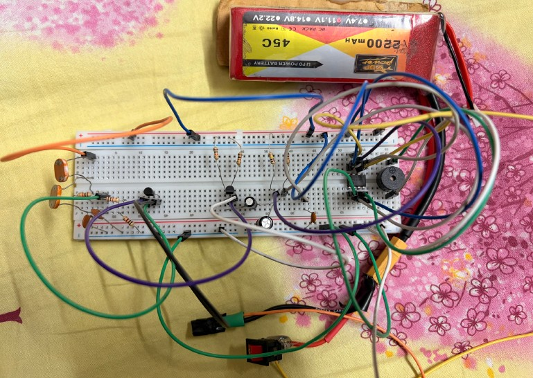
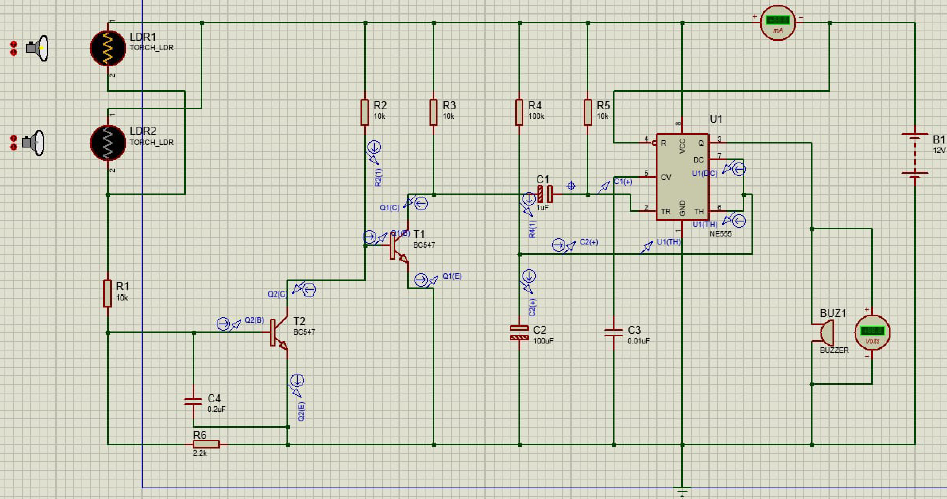
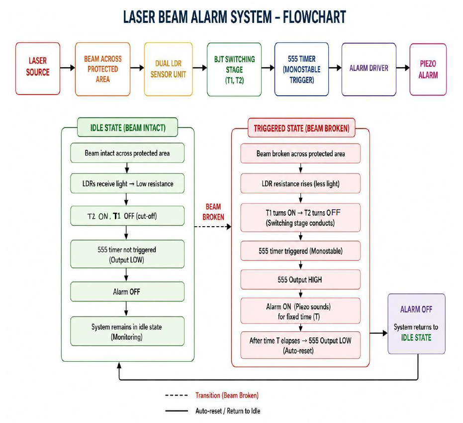

# Smart Laser Alarm with Dual LDR Intruder Detection

An electronics-based security alarm system that detects unauthorized movement by monitoring the interruption of a laser beam using two Light Dependent Resistors (LDRs). The system uses a transistor switching stage and a 555 Timer IC operating in monostable mode to activate an alarm for a predetermined duration.

## Project Overview

The Smart Laser Alarm is designed to provide a simple and cost-effective security solution for monitoring a protected area.

A laser beam is directed toward two LDR sensors positioned across the protected zone. Under normal conditions, the laser continuously illuminates the sensors, keeping the circuit in its idle state.

When an object interrupts the laser beam, the LDR resistance changes. The transistor switching stage detects this change and generates a trigger signal for the 555 Timer IC. The timer activates a piezo buzzer for a predetermined period and automatically resets the system afterward.

The dual-LDR arrangement is intended to improve detection selectivity and reduce unwanted triggering from smaller disturbances.

## Features

- Laser-based intrusion detection.
- Dual-LDR sensing mechanism.
- BJT transistor-based switching circuit.
- 555 Timer IC in monostable configuration.
- Automatic alarm activation and reset.
- Adjustable alarm duration through timing components.
- Proteus circuit simulation.
- Breadboard-based hardware implementation.

## How It Works

The system operates through the following stages:

1. **Laser Transmission:** A laser module continuously directs a beam toward the two LDR sensors.
2. **Light Detection:** Both LDRs receive light and maintain relatively low resistance.
3. **Intrusion Detection:** When an object blocks the laser beam, the light intensity decreases and the LDR resistance increases.
4. **Transistor Switching:** The BJT switching stage responds to the change in the LDR sensing circuit.
5. **555 Timer Activation:** A trigger pulse is applied to pin 2 of the 555 Timer IC.
6. **Alarm Activation:** The timer produces a HIGH output, activating the piezo buzzer.
7. **Automatic Reset:** After the preset time expires, the timer output returns LOW and the system becomes ready for the next detection.

## Block Diagram

```text
      LASER MODULE
            |
            v
    PROTECTED AREA
            |
            v
      DUAL LDR UNIT
            |
            v
    BJT SWITCHING STAGE
        (T1 and T2)
            |
            v
      555 TIMER IC
       (Monostable)
            |
            v
       ALARM DRIVER
            |
            v
       PIEZO BUZZER
```

## Components Required

| Component | Specification |
|---|---|
| Timer IC | NE555 |
| Transistors | T1 and T2 (BJT) |
| LDR Sensors | 2 × Standard LDR |
| R1, R2, R3, R5 | 10 kΩ |
| R4 | 100 kΩ (as listed in the report) |
| C1 | 1 µF / 25 V |
| C2 | 100 µF / 25 V |
| C3 | 0.01 µF |
| C4 | 0.22 µF |
| Alarm | 12 V, 200 mA piezo buzzer |
| Laser Source | Standard laser pointer/diode |
| Power Supply | 9–12 V DC |
| Other Materials | Breadboard and connecting wires |

## 555 Timer Operation

The NE555 Timer IC operates in **Monostable Multivibrator Mode**.

In this configuration, the timer produces a single output pulse when it receives a valid trigger signal.

The timing duration is determined by:

\[
T = 1.1RC
\]

Where:

- T = Output pulse duration in seconds.
- R = Timing resistance in ohms.
- C = Timing capacitance in farads.

When the laser beam is interrupted, the timer is triggered and its output becomes HIGH. The timing capacitor charges until its voltage reaches approximately two-thirds of the supply voltage. The timer then switches its output LOW and resets automatically.

## Capacitor Functions

| Capacitor | Function |
|---|---|
| C1 | Trigger coupling capacitor |
| C2 | Main timing capacitor |
| C3 | 555 Timer noise-filtering capacitor |
| C4 | LDR sensing circuit stabilization capacitor |

## Simulation and Hardware Implementation

The circuit was designed and simulated using Proteus to examine its operation under normal and intrusion conditions.

A physical prototype was also assembled on a breadboard using the required electronic components.

### Hardware Prototype



### Proteus Simulation



### System Flowchart



## Applications

- Basic home security systems.
- Door and entrance monitoring.
- Laboratory security demonstrations.
- Restricted-area intrusion detection.
- Electronics and embedded-system learning projects.

## Future Improvements

- Wireless notification through Wi-Fi or GSM.
- Integration with an Arduino or ESP32.
- Battery backup for uninterrupted operation.
- Multiple laser detection zones.
- Improved ambient-light rejection.
- Adjustable sensitivity and alarm duration.

## Technologies and Tools

- **Electronics:** NE555 Timer, LDR, BJT Transistors, capacitors and resistors.
- **Simulation:** Proteus Design Suite.
- **Prototyping:** Breadboard and electronic components.
- **Documentation:** Markdown and GitHub.

## Project Team

Developed as a team mini-project for Electronics I Lab (EEE 4204), Islamic University of Technology (IUT).

- Shihab Shahriar Sami
- Yasir Arafat
- Ishmam Dibya
- Istiak Sarker
- Maisha Ahmed Raika
- Ashjai Arabi

## License

This project is available for educational and learning purposes. See the LICENSE file for licensing information.
